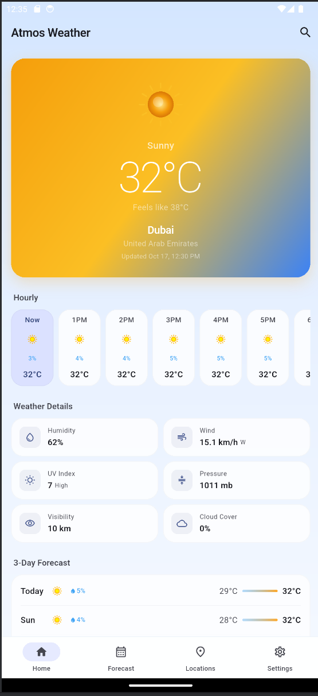
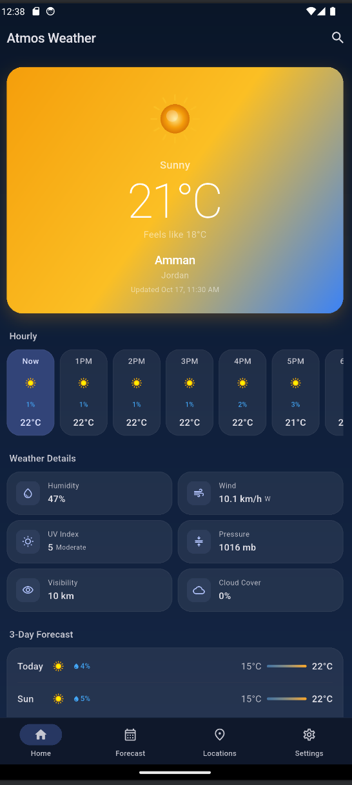
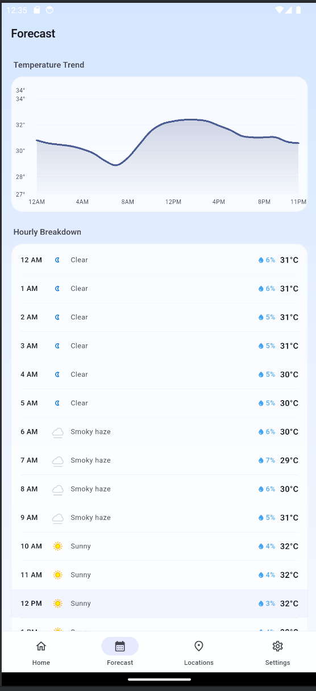
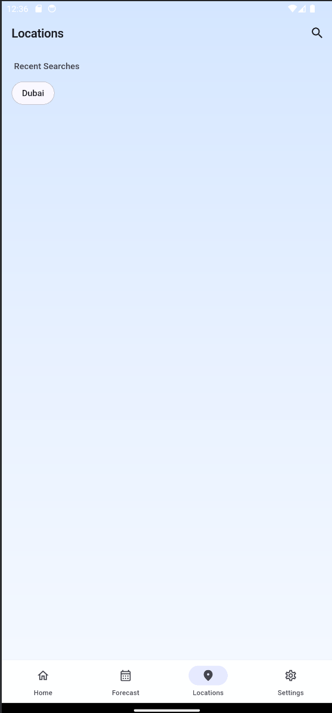
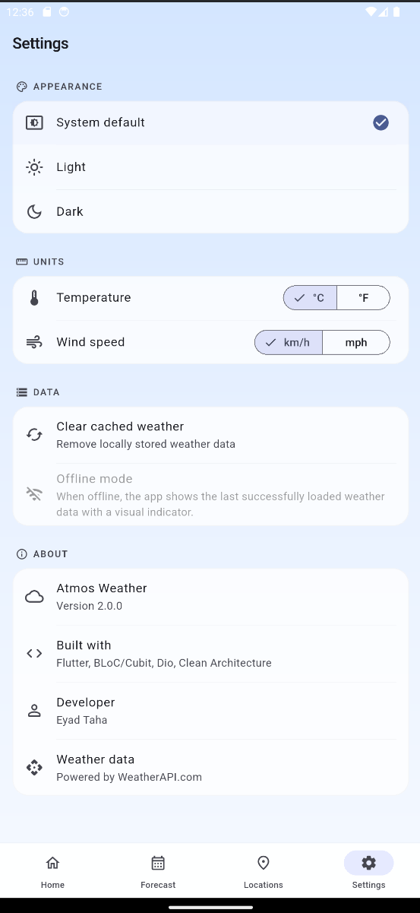

# Atmos Weather

A polished Flutter weather application featuring real-time weather data, multi-day forecasts, multi-city management, offline caching, and a premium light/dark UI — built with Clean Architecture and Cubit state management.

## Features

- **Real-Time Weather** — Current conditions including temperature, humidity, wind, UV index, pressure, visibility, and cloud cover
- **3-Day Forecast** — Daily and hourly forecast with interactive temperature chart
- **Multi-City Management** — Search, save, and switch between favorite locations
- **Offline Support** — Automatic caching of the last loaded weather data with visual offline indicator
- **Light & Dark Themes** — Material 3 theming with system, light, and dark mode options
- **Weather-Aware Gradients** — Dynamic hero card backgrounds that adapt to current weather conditions (sunny, cloudy, rain, snow, storm, fog, night)
- **Custom Weather Illustrations** — Hand-drawn CustomPainter-based weather icons (sun, clouds, rain, snow, lightning, fog, moon)
- **Unit Preferences** — Toggle between Celsius/Fahrenheit and km/h/mph
- **Pull-to-Refresh** — Swipe down to refresh weather data
- **Elegant State Handling** — Shimmer loading skeletons, friendly error states, and empty-state illustrations

## Screenshots

> Screenshots are not yet included. Add your own to the `screenshots/` directory and update the references below.

| Home (Light) | Home (Dark) | Forecast | Locations | Settings |
|:---:|:---:|:---:|:---:|:---:|
| *home_light.png* | *home_dark.png* | *forecast_light.png* | *locations.png* | *settings_light.png* |

<!--
Uncomment and update paths once screenshots are added:
|  |  |  |  |  |
-->

## Tech Stack

| Category | Technology |
|---|---|
| Framework | Flutter 3.x (Dart 3.x) |
| State Management | flutter_bloc / Cubit |
| Networking | Dio |
| Local Storage | SharedPreferences |
| Dependency Injection | GetIt |
| Error Handling | Dartz (Either monad) |
| Charts | fl_chart |
| Date Formatting | intl |
| Testing | flutter_test, bloc_test, mocktail |

## Architecture

The project follows **Clean Architecture** with a feature-first directory structure:

```
lib/
├── app/                          # App entry point and shell
│   ├── app.dart                  # MaterialApp configuration
│   └── app_shell.dart            # Bottom navigation shell
├── config/
│   └── service_locator.dart      # GetIt dependency registration
├── core/
│   ├── constants/                # App-wide constants and API config
│   ├── design_system/            # Colors, spacing, weather theme mapping
│   ├── error/                    # Exception and Failure types
│   ├── network/                  # Dio HTTP client
│   ├── theme/                    # Material 3 theme, ThemeCubit
│   └── widgets/                  # Shared widgets (shimmer, weather icons)
├── features/
│   ├── weather/
│   │   ├── data/
│   │   │   ├── datasources/      # Remote (API) and Local (cache) sources
│   │   │   ├── models/           # JSON serialization models
│   │   │   └── repositories/     # Repository implementation
│   │   ├── domain/
│   │   │   ├── entities/         # Business objects
│   │   │   └── repositories/     # Repository contract
│   │   └── presentation/
│   │       ├── cubit/            # WeatherCubit + states
│   │       ├── pages/            # Home page
│   │       └── widgets/          # Hero section, metrics grid, hourly strip
│   ├── forecast/
│   │   └── presentation/
│   │       ├── pages/            # Forecast page
│   │       └── widgets/          # Temperature chart, hourly list, daily card
│   ├── locations/
│   │   └── presentation/
│   │       ├── cubit/            # LocationsCubit + states
│   │       └── pages/            # Locations page with search
│   └── settings/
│       └── presentation/
│           ├── cubit/            # SettingsCubit + states
│           └── pages/            # Settings page
└── main.dart
```

### Data Flow

```
UI (Widgets) → Cubit → Repository → DataSource (Remote / Local)
                 ↑                        ↓
              State ← Either<Failure, Entity> ← Model.fromJson()
```

- **Cubits** orchestrate business logic and emit immutable state objects
- **Repositories** coordinate between remote and local data sources, returning `Either<Failure, T>`
- **Data Sources** handle raw HTTP calls (Dio) and local caching (SharedPreferences)
- **Entities** are pure domain objects consumed by the UI

## State Management

The app uses **Cubit** (from the BLoC library) for state management:

| Cubit | Responsibility |
|---|---|
| `WeatherCubit` | Fetches weather by city, manages caching fallback on network errors, tracks recent searches |
| `LocationsCubit` | City search via API, saved favorites via SharedPreferences |
| `SettingsCubit` | Temperature and wind speed unit preferences |
| `ThemeCubit` | Light / dark / system theme persistence |

## WeatherAPI Integration

The app consumes the [WeatherAPI.com](https://www.weatherapi.com/) REST API:

| Endpoint | Usage |
|---|---|
| `forecast.json` | Current weather + 3-day forecast with hourly data |
| `search.json` | City autocomplete search |

The API key is injected at build time via `--dart-define` — it is never hardcoded in source code.

## Offline Caching

- Weather data is serialized to JSON and stored in SharedPreferences after each successful API call
- When the network is unavailable, the app automatically falls back to cached data
- A visual "Offline" pill badge appears on the hero card when displaying cached data
- Users can manually clear the cache from Settings

## Light and Dark Themes

- Built on Material 3 with `ColorScheme.fromSeed`
- Three modes: System default, Light, Dark
- Theme preference persists across app restarts via SharedPreferences
- Weather hero card uses condition-aware gradient backgrounds that adapt to both the weather type and the selected theme

## Getting Started

### Prerequisites

- Flutter SDK 3.x ([installation guide](https://docs.flutter.dev/get-started/install))
- A free API key from [WeatherAPI.com](https://www.weatherapi.com/signup.aspx)

### Installation

1. **Clone the repository:**

   ```bash
   git clone https://github.com/Eyad5/atmos-weather-flutter-showcase.git
   cd atmos-weather-flutter-showcase
   ```

2. **Install dependencies:**

   ```bash
   flutter pub get
   ```

3. **Configure your API key:**

   Copy the example configuration file and add your key:

   ```bash
   cp weather_config.json.example weather_config.json
   ```

   Edit `weather_config.json` and replace the placeholder with your actual API key:

   ```json
   {
     "WEATHER_API_KEY": "your_actual_api_key_here"
   }
   ```

   > **Important:** `weather_config.json` is listed in `.gitignore` and must never be committed to version control.

4. **Run the app:**

   ```bash
   flutter run --dart-define-from-file=weather_config.json
   ```

   Or use the provided VS Code launch configuration if you set one up.

### API Key Configuration

The app reads the API key at build time via Dart's `String.fromEnvironment`:

```dart
static const String weatherApiKey = String.fromEnvironment('WEATHER_API_KEY');
```

This means the key is compiled into the binary at build time and is never present in source code. You can also pass the key directly:

```bash
flutter run --dart-define=WEATHER_API_KEY=your_key_here
```

## Testing and Build Verification

```bash
# Static analysis
flutter analyze

# Run all tests (28 tests)
flutter test

# Build debug APK
flutter build apk --debug --dart-define-from-file=weather_config.json
```

### Test Coverage

| Test Suite | Tests | Covers |
|---|---|---|
| `theme_cubit_test.dart` | 8 | Theme mode persistence and state |
| `settings_cubit_test.dart` | 9 | Unit preferences, formatting, persistence |
| `weather_model_test.dart` | 4 | JSON parsing, cache round-trip, entity conversion |
| `weather_cubit_test.dart` | 6 | Search, error handling, cache fallback, initialization |
| `widget_test.dart` | 1 | Placeholder |
| **Total** | **28** | |

## Project Status

This is a portfolio project demonstrating Flutter development skills. It is not published on Google Play or the App Store.

**Verified:**
- `flutter analyze` — 0 issues
- `flutter test` — 28/28 passed
- `flutter build apk --debug` — Build successful

## Developer

**Eyad Taha** — Flutter Developer

GitHub: [github.com/Eyad5](https://github.com/Eyad5)
