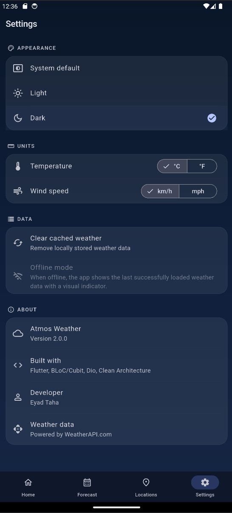

# Atmos Weather — Flutter Portfolio Showcase

A premium Flutter weather application demonstrating Clean Architecture, Cubit state management, REST API integration, offline caching, and Material 3 theming.

> **Full Source Code:** [github.com/Eyad5/weather-offline-app](https://github.com/Eyad5/weather-offline-app)

---

## Overview

Atmos Weather is a full-featured weather application built with Flutter, designed as a professional portfolio project. It demonstrates real-world mobile development patterns including Clean Architecture, reactive state management, network-first caching strategies, and polished UI design with weather-aware theming.

## Key Features

| Feature | Description |
|---|---|
| **Real-Time Weather** | Current conditions via WeatherAPI.com — temperature, humidity, wind, UV index, pressure, visibility, cloud cover |
| **3-Day Forecast** | Daily and hourly forecast with interactive temperature chart (fl_chart) |
| **Multi-City Management** | Search cities, save favorites, switch between locations |
| **Offline Support** | Automatic caching with visual offline indicator when displaying cached data |
| **Light & Dark Themes** | Material 3 theming with system, light, and dark mode options |
| **Weather-Aware Gradients** | Hero card backgrounds that adapt to current weather conditions (sunny, cloudy, rain, snow, storm, fog, night) |
| **Custom Illustrations** | CustomPainter-based weather icons — sun, clouds, rain, snow, lightning, fog, moon |
| **Unit Preferences** | Celsius/Fahrenheit and km/h/mph toggle |
| **Shimmer Loading** | Skeleton loading animations across all screens |
| **Pull-to-Refresh** | Swipe to refresh weather data |

## Screenshots

> Screenshots are not yet included. They will be added to the `screenshots/` directory.

<!--
Uncomment once screenshots are available:

| Home (Light) | Home (Dark) | Forecast |
|:---:|:---:|:---:|
|  |  |  |

| Locations | Settings (Light) | Settings (Dark) |
|:---:|:---:|:---:|
|  |  |  |
-->

## Tech Stack

| Category | Technology |
|---|---|
| Framework | Flutter 3.x (Dart 3.x) |
| State Management | flutter_bloc / Cubit |
| Networking | Dio |
| Local Storage | SharedPreferences |
| Dependency Injection | GetIt |
| Error Handling | Dartz (Either monad) |
| Charts | fl_chart |
| Testing | flutter_test, bloc_test, mocktail |

## Architecture

The application follows **Clean Architecture** with a feature-first directory structure:

```
lib/
├── app/                          # App entry point and navigation shell
├── config/                       # Dependency injection (GetIt)
├── core/
│   ├── constants/                # API config (build-time injection)
│   ├── design_system/            # Colors, spacing, weather theme mapping
│   ├── error/                    # Exception and Failure types
│   ├── network/                  # Dio HTTP client
│   ├── theme/                    # Material 3 theme and ThemeCubit
│   └── widgets/                  # Shared widgets (shimmer, weather icons)
├── features/
│   ├── weather/                  # Home — current conditions
│   │   ├── data/                 # API calls, caching, JSON models
│   │   ├── domain/               # Entities, repository contract
│   │   └── presentation/         # Cubit, pages, widgets
│   ├── forecast/                 # Forecast — chart, hourly, daily
│   ├── locations/                # Locations — search, favorites
│   └── settings/                 # Settings — theme, units, cache
└── main.dart
```

### Data Flow

```
UI → Cubit → Repository → DataSource (Remote / Local)
       ↑                        ↓
    State ← Either<Failure, Entity> ← Model.fromJson()
```

## State Management

| Cubit | Responsibility |
|---|---|
| `WeatherCubit` | Fetches weather, manages caching fallback, tracks recent searches |
| `LocationsCubit` | City search via API, saved favorites |
| `SettingsCubit` | Temperature and wind speed unit preferences |
| `ThemeCubit` | Light / dark / system theme persistence |

## API Integration

The app consumes the [WeatherAPI.com](https://www.weatherapi.com/) REST API:

- `forecast.json` — Current weather + 3-day forecast with hourly data
- `search.json` — City autocomplete search

The API key is injected at build time via `--dart-define-from-file` and is never hardcoded in source code.

## Offline Strategy

1. Weather data is cached in SharedPreferences after each successful API call
2. On network failure, the app falls back to cached data automatically
3. A visual "Offline" badge appears on the hero card
4. Cache can be cleared manually from Settings

## Verification

| Check | Result |
|---|---|
| `flutter analyze` | 0 issues |
| `flutter test` | 28/28 passed |
| `flutter build apk --debug` | Build successful |

## Getting Started

See the **[source code repository](https://github.com/Eyad5/weather-offline-app)** for full setup instructions, including API key configuration and build commands.

## Project Status

This is a portfolio project demonstrating Flutter development skills. It is not published on Google Play or the App Store.

---

## Developer

**Eyad Taha** — Flutter Developer

GitHub: [github.com/Eyad5](https://github.com/Eyad5)
